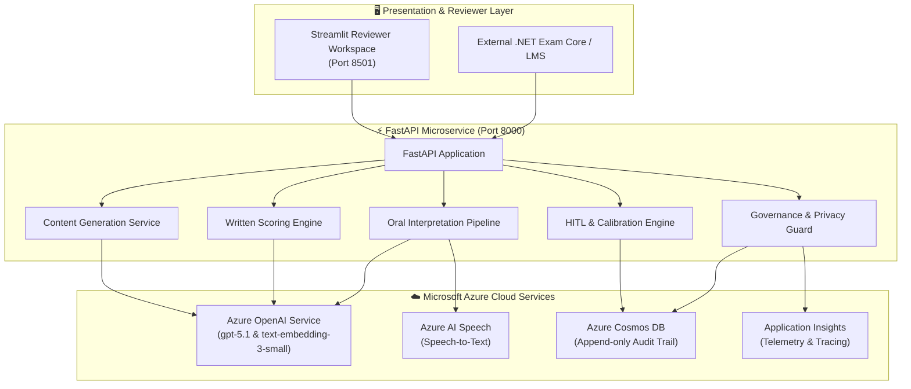

# 🏗️ LinguaProctor — System Architecture & Azure Cloud Blueprint

## System Architecture

---

## Azure Infrastructure Components

The authoritative inventory, identity model and validation record is in
[infrastructure.md](infrastructure.md). Deployment steps are in
[deployment-guide.md](deployment-guide.md). Design decisions are in
[adr/](adr/README.md). In summary:

1. **Azure OpenAI** (keys disabled, Entra ID only):
   - `chat` deployment: gpt-5.1 (GlobalStandard) for meaning-unit decomposition,
     alignment, rubric scoring, terminology judgement and passage generation.
   - `embedding` deployment: text-embedding-3-small for oral transcript
     alignment and duplicate detection.

2. **Azure AI Speech** (keys disabled; custom subdomain for Entra ID):
   - Continuous speech-to-text with word-level timestamps for `en-US` and
     Arabic locales (`ar-AE`, `ar-SA`, `ar-EG`).

3. **Azure Cosmos DB** (serverless, keys disabled):
   - `audit` container: the append-only audit trail. The API identity holds a
     custom role that can create and read items but not replace or delete them.

4. **Azure Container Apps + Container Registry**: the API (internal ingress,
   single replica) and the reviewer dashboard, pulled with managed identity.

5. **Log Analytics + Application Insights**: OpenTelemetry request tracing,
   container logs and diagnostic logs from every AI and data resource.

No Blob Storage is provisioned. Candidate audio is processed in memory and not
retained ([ADR 0006](adr/0006-provision-only-what-runs.md)).
