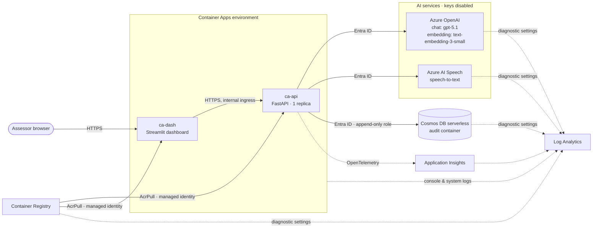

# LinguaProctor infrastructure reference

This document describes the Azure resources LinguaProctor needs and why each one
exists. It also covers how the resources are secured and wired to the
application, and how the infrastructure was validated. To deploy, follow the
[deployment guide](deployment-guide.md). Design rationale is in the
[architecture decision records](adr/README.md).

- [Architecture](#architecture)
- [Resource inventory](#resource-inventory)
- [Identity and access](#identity-and-access)
- [Configuration contract](#configuration-contract)
- [Networking](#networking)
- [Observability](#observability)
- [Model lifecycle](#model-lifecycle)
- [Cost drivers](#cost-drivers)
- [Repository layout](#repository-layout)
- [Validation](#validation)
- [Production readiness](#production-readiness)

## Architecture



All resources are in one resource group, `rg-<environment>`. Azure OpenAI can
be in a different region (`openAiLocation`) to follow model availability and
quota.

## Resource inventory

Every resource below is required by a specific code path. Nothing is
provisioned speculatively ([ADR 0006](adr/0006-provision-only-what-runs.md)).

| Resource | Name | SKU / mode | Required by | Notes |
|---|---|---|---|---|
| Resource group | `rg-<env>` | – | – | Tagged `azd-env-name`, `application` |
| User-assigned managed identity | `id-api-<token>` | – | API: all Azure data-plane calls, image pulls | Selected via `AZURE_CLIENT_ID` |
| User-assigned managed identity | `id-dash-<token>` | – | Dashboard image pulls | AcrPull only |
| Azure OpenAI | `cog-oai-<token>` | S0 | `src/infrastructure/azure_openai_client.py` | `disableLocalAuth`, custom subdomain |
| ↳ deployment `chat` | | gpt-5.1 `2025-11-13`, GlobalStandard, 30K TPM | Written scoring, oral scoring, content generation | See [model lifecycle](#model-lifecycle) |
| ↳ deployment `embedding` | | text-embedding-3-small `1`, GlobalStandard, 30K TPM | Oral transcript alignment, duplicate detection | |
| Azure AI Speech | `cog-spch-<token>` | S0 | `src/infrastructure/azure_speech_client.py` (oral STT) | `disableLocalAuth`; custom subdomain enables Entra ID |
| Cosmos DB (NoSQL) | `cosmos-<token>` | Serverless | `src/governance/audit_logger.py` | `disableLocalAuth`, TLS 1.2 |
| ↳ database / container | `linguaproctor` / `audit` | Partition key `/partitionKey` (v2) | Durable audit trail | Append-only role ([ADR 0004](adr/0004-append-only-audit-store.md)) |
| Container Registry | `cr<token>` | Basic | Images built by `azd deploy` (ACR Tasks) | Admin user disabled |
| Container Apps environment | `cae-<token>` | Workload profiles, Consumption | Hosts both apps | Logs to Log Analytics |
| Container app | `ca-api-<token>` | 1 vCPU / 2 GiB, 1 replica | FastAPI (`src/main.py`) | Internal ingress by default |
| Container app | `ca-dash-<token>` | 0.5 vCPU / 1 GiB, 1–2 replicas | Streamlit (`dashboard/app.py`) | External ingress, sticky sessions, optional IP allow-list |
| Log Analytics workspace | `log-<token>` | PerGB2018, 30-day retention | Central log sink | Resource-permission access mode |
| Application Insights | `appi-<token>` | Workspace-based | `src/main.py` OpenTelemetry instrumentation | Enabled when the connection string is set |

`<token>` is `uniqueString(subscription, environmentName, location)`, so names
are stable per environment and unique across subscriptions. Prefixes are in
`infra/abbreviations.json`.

**Removed from the original templates:**

| Removed | Reason |
|---|---|
| Storage account (`audio`, `documents`, `examinations`) | Unused |
| Cosmos containers `exams` and `results` | Unused |
| Cosmos free tier | Fails if the subscription already has a free-tier account |
| All key and connection-string secrets | Replaced by managed identity |

## Identity and access

No resource accepts keys. All access is Microsoft Entra ID with role-based
access control ([ADR 0001](adr/0001-keyless-authentication.md)).

| Principal | Scope | Role | Purpose |
|---|---|---|---|
| `id-api` | Azure OpenAI | Cognitive Services OpenAI User | Chat and embeddings inference |
| `id-api` | AI Speech | Cognitive Services Speech User | Speech-to-text |
| `id-api` | Cosmos `audit` container | *LinguaProctor Audit Appender* (custom) | create, read and query items only. No replace, upsert or delete. |
| `id-api` | Container Registry | AcrPull | Pull the API image |
| `id-dash` | Container Registry | AcrPull | Pull the dashboard image |
| `principalId` (developer or CI) | Azure OpenAI, AI Speech | OpenAI User, Speech User | Run the API locally against Azure (`az login`) |
| `principalId` (developer or CI) | Cosmos account | Cosmos DB Built-in Data Contributor | Inspect the audit data during development |

Built-in role GUIDs live in `infra/modules/types.bicep` and were verified
against Microsoft Entra on 2026-11-04. The `principalId` grants are optional.
Omit `AZURE_PRINCIPAL_ID` in production environments.

## Configuration contract

`main.bicep` outputs are written to the azd environment. They feed the app
deployments (`infra/app/*.parameters.json`) and local development
(`infra/scripts/write-env.*` → `.env.azure`). None of them is a secret.

| Container app environment variable | Read by | Value |
|---|---|---|
| `AZURE_CLIENT_ID` | `azure-identity` | API managed identity client ID |
| `AZURE_OPENAI_ENDPOINT` | `AzureOpenAISettings.endpoint` | Account endpoint |
| `AZURE_OPENAI_API_VERSION` | `.api_version` | `2025-04-01-preview` |
| `AZURE_OPENAI_CHAT_DEPLOYMENT` / `_EMBEDDING_DEPLOYMENT` | `.chat_deployment` / `.embedding_deployment` | `chat` / `embedding` |
| `AZURE_OPENAI_CHAT_REASONING_MODEL` | `.chat_reasoning_model` | Derived from the model name |
| `AZURE_SPEECH_ENDPOINT`, `AZURE_SPEECH_REGION` | `AzureSpeechSettings` | Custom-domain endpoint, region |
| `COSMOS_ENDPOINT`, `COSMOS_DATABASE_NAME`, `COSMOS_AUDIT_CONTAINER` | `CosmosSettings` | Account endpoint, `linguaproctor`, `audit` |
| `APPLICATIONINSIGHTS_CONNECTION_STRING` | Azure Monitor exporter | Ingestion connection string |
| `APP_ENVIRONMENT`, `APP_DEBUG` | `AppSettings` | azd environment name, `false` |
| `LINGUAPROCTOR_API_URL` (dashboard) | `dashboard/components/api.py` | API URL inside the environment |

`tests/test_infrastructure.py` fails if a container app sets a variable the
application never reads. That defect class (for example `APP_ENV` vs.
`APP_ENVIRONMENT`) previously left settings silently ignored.

## Networking

| Path | Default | Change with |
|---|---|---|
| Internet → dashboard | Public HTTPS ingress | `DASHBOARD_ALLOWED_IP_RANGES="203.0.113.0/24,…"` restricts to CIDR ranges |
| Internet → API | **Not exposed** (internal ingress) | `API_EXTERNAL_INGRESS=true`, for example for an external exam platform. See below. |
| Dashboard → API | `https://<api>.internal.<env-domain>` | – |
| Apps → OpenAI, Speech, Cosmos, ACR | Public endpoints, Entra ID authenticated | See [production readiness](#production-readiness) for private endpoints |

> [!IMPORTANT]
> The API and dashboard have **no user authentication**. Anyone who can reach
> the dashboard can approve or override scores as any reviewer ID. Before real
> candidates are assessed, enable Container Apps built-in authentication
> (Microsoft Entra ID) on the dashboard. Don't set `API_EXTERNAL_INGRESS=true`
> without an authentication layer in front of the API.

## Observability

| Signal | Destination | Source |
|---|---|---|
| Request traces, dependency calls, metrics | Application Insights | OpenTelemetry FastAPI instrumentation (`src/main.py`) |
| Container stdout/stderr, system events | Log Analytics `ContainerAppConsoleLogs_CL`, `ContainerAppSystemLogs_CL` | Container Apps environment |
| OpenAI, Speech, Cosmos, ACR audit, request and metric logs | Log Analytics | Diagnostic settings (`allLogs`, Cosmos in resource-specific tables) |
| Token usage and cost | `GET /api/v1/admin/usage` | `CostTracker` (in process) |

Useful queries:

```kusto
// API errors in the last hour
ContainerAppConsoleLogs_CL
| where ContainerAppName_s startswith "ca-api" and Log_s has_any ("ERROR", "Traceback")
| where TimeGenerated > ago(1h)

// Azure OpenAI throttling (429) by deployment
AzureDiagnostics
| where ResourceProvider == "MICROSOFT.COGNITIVESERVICES" and ResultSignature == "429"
| summarize throttled = count() by bin(TimeGenerated, 5m), Resource
```

Recommended alerts (not provisioned yet): container restarts > 0, API 5xx rate,
OpenAI 429 rate, Cosmos 403s, and a Service Health alert for **Azure OpenAI
Service** retirement advisories.

## Model lifecycle

| Deployment | Model | Version | Lifecycle (2026-11-04) | Retires |
|---|---|---|---|---|
| `chat` | gpt-5.1 | 2025-11-13 | GA | 2027-07-13 |
| `embedding` | text-embedding-3-small | 1 | GA | 2028-02-09 |

The previous default (gpt-4o `2024-08-06`, regional Standard) is **blocked for
new subscriptions** and retires 2027-04-14. It would have failed to provision
([ADR 0002](adr/0002-chat-model-gpt-5-1.md)).

Deployments use `versionUpgradeOption: OnceCurrentVersionExpired`, so the grading
model never changes silently. To change models, override the `chatModel`
parameter and re-run the expert regression suite
(`python -m evaluation.regression_tests`) before release. If the new model
isn't a reasoning model, also set `chatModelIsReasoning`.

> [!NOTE]
> GlobalStandard can process prompts in any Azure geography. For data-residency
> requirements use `DataZoneStandard` (where offered) or a regional or
> provisioned deployment. Data Zone isn't offered in `uaenorth`.

## Cost drivers

Use the [Azure pricing calculator](https://azure.microsoft.com/pricing/calculator/)
with your volumes. The structure is:

| Resource | Billing driver | Idle cost |
|---|---|---|
| Azure OpenAI | Input and output tokens per call (reasoning tokens bill as output) | None |
| AI Speech | Audio hours transcribed | None |
| Container Apps | vCPU-seconds and GiB-seconds. Both apps keep ≥ 1 replica. | **Yes**, always-on replicas |
| Cosmos DB serverless | Request units and storage | Storage only |
| Log Analytics / Application Insights | GB ingested (diagnostic logs dominate) | Low |
| Container Registry Basic | Daily fixed fee, plus ACR Tasks build minutes | Yes (small) |

Each written script costs three LLM calls (decompose, align, rubric), plus one
per glossary term not resolved deterministically. Each oral attempt costs one
STT session, two embeddings calls (source and candidate segments) and one LLM call.

## Repository layout

```
azure.yaml                       azd project: services, hooks, required azd version
infra/
  bicepconfig.json               linter: security and best-practice rules as errors
  main.bicep                     platform (subscription scope) — `azd provision`
  main.parameters.json           azd environment → parameters
  abbreviations.json             resource name prefixes
  modules/
    types.bicep                  shared types and built-in role IDs
    monitoring.bicep             Log Analytics + Application Insights
    identity.bicep               user-assigned managed identity
    openai.bicep                 Azure OpenAI + deployments + RBAC + diagnostics
    speech.bicep                 AI Speech + RBAC + diagnostics
    cosmos.bicep                 Cosmos DB + audit container + append-only role
    container-registry.bicep     ACR + AcrPull + diagnostics
    container-apps-environment.bicep
  app/
    api.bicep (+ .parameters.json)        API container app — `azd deploy`
    dashboard.bicep (+ .parameters.json)  dashboard container app — `azd deploy`
  scripts/write-env.{sh,ps1}     postprovision: writes .env.azure for local dev
.github/workflows/
  ci-cd.yml                      lint, tests (incl. Bicep build + infra contract), images
  azure-dev.yml                  manual provision + deploy (OIDC)
```

## Validation

Performed on 2026-11-04 against subscription "Azure subscription 1", region
`uaenorth`. All checks were read-only: no resources were created, and the
subscription was confirmed unchanged afterwards (no resource group, no
deployment records, provider registration unchanged).

| Check | Result |
|---|---|
| `az bicep build` on all templates (Bicep 0.48.1) with lint rules as errors | Pass |
| ARM preflight `az deployment sub validate` on `main.bicep` | **Succeeded** |
| ARM what-if on `main.bicep` | 22 resources to create. The 5 role assignments whose names depend on identities created in the same deployment show as "Unsupported" (a what-if limitation). |
| Model availability via Models API in `uaenorth`, `swedencentral`, `eastus2` | gpt-5.1 `2025-11-13` and text-embedding-3-small `1` are GA on GlobalStandard |
| Quota in `uaenorth` | gpt-5.1 GlobalStandard 0/250K TPM used. text-embedding-3-small GlobalStandard 0/1000K TPM. |
| Built-in role definition GUIDs | Verified against Microsoft Entra |
| `tests/test_infrastructure.py` (12 tests) | Pass. Mutation-tested: re-enabling Speech keys, an env var the app never reads, a missing deploy parameter, a delete-capable audit role, and a Dockerfile/ingress port mismatch were each caught. |
| Keyless auth paths (`tests/test_azure_auth.py`) | Pass. OpenAI token provider, Speech `token_credential`, Cosmos audit client, reasoning-model request shape. |

**Not validated:**

- **Actual deployment (`azd up`).** It would create billable resources, so it
  wasn't run.
- **ARM what-if of `infra/app/*.bicep`.** These reference platform resources
  that don't exist until provisioning.
- **The container image build.** No Docker was available locally; azd builds
  remotely in ACR.
- **Live GPT-5.1 scoring quality** against the expert set.

Run the deployment guide end to end in a sandbox subscription before
production.

## Production readiness

| Area | Status | Action before production |
|---|---|---|
| User authentication | ❌ none | Enable Container Apps authentication (Entra ID) on the dashboard; map reviewer IDs to signed-in identities |
| State durability / scale-out | ⚠️ audit only | Persist results, review queue and calibration in Cosmos; then allow > 1 API replica ([ADR 0005](adr/0005-single-replica-api.md)) |
| Network isolation | ⚠️ public endpoints | VNet-integrated environment, private endpoints for OpenAI/Speech/Cosmos/ACR (ACR Premium), `publicNetworkAccess: Disabled` |
| Resilience | ⚠️ single zone | Zone-redundant environment (requires VNet) and Cosmos; consider a second OpenAI region |
| Backup | ⚠️ periodic (default) | Cosmos continuous backup for point-in-time restore of the audit trail |
| Data residency | ⚠️ GlobalStandard | Choose a deployment type that meets the regulator's requirements |
| Alerting and budgets | ❌ | Add the alerts in [Observability](#observability) and an Azure budget on the resource group |
| Policy and posture | ❌ | Assign Azure Policy (e.g. Microsoft cloud security benchmark), enable Defender for Cloud, add PSRule for Azure to CI |
| Secrets | ✅ none exist | – |
| Least privilege | ✅ per-workload identities, append-only audit role | Remove developer grants (`AZURE_PRINCIPAL_ID`) in production |
