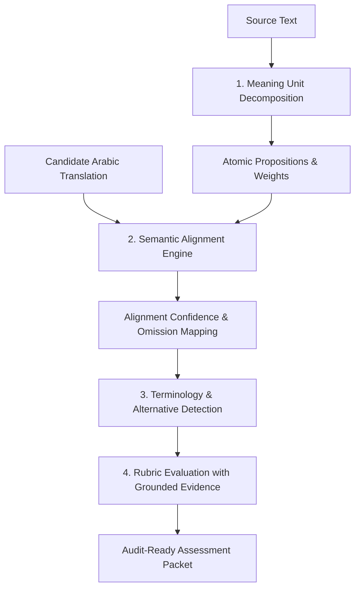

# 📐 LinguaProctor — Scoring & Calibration Methodology

## 1. Overview
LinguaProctor moves translation assessment away from monolithic black-box grading towards an **explainable, meaning-unit decomposition architecture**.

Standard automated metrics (BLEU, chrF, BERTScore) fall short in high-stakes professional examination because:
1. They require exact string overlap or superficial vector proximity.
2. They fail to distinguish between critical legal omissions vs. valid regional synonyms (e.g. UAE vs Egyptian statutory phrasing).
3. They provide no evidentiary breakdown that human assessors can defend during appeals or accreditation audits.

---

## 2. Four-Stage Scoring Pipeline

### Stage 1: Meaning Unit Decomposition
The source passage is parsed into atomic semantic units:
- Main clauses
- Conditional dependencies (`if... then...`)
- Numerical & temporal constraints
- Definitions & exceptions

Each unit is assigned an **importance weight** ($w_i \in [0.1, 1.0]$).

### Stage 2: Cross-Lingual Semantic Alignment
The alignment engine identifies corresponding spans in the Arabic candidate translation. 
- Units without candidate spans are flagged as **Omissions**.
- Candidate spans unaligned with source units are scrutinized as **Unwarranted Additions**.

### Stage 3: Three-Tier Valid Alternative Detection
Arabic features extensive regional and stylistic variation. Each glossary entry is resolved in order:
1. **Canonical match**: the expected term appears in the candidate (after Arabic normalisation: diacritics, tatweel, alef/yaa/taa-marbuta variants).
2. **Authoritative lexicon**: one of the entry's officially accepted `alternatives` appears. This is deterministic, with no model call, so a listed variant can never be penalised.
3. **Contextual LLM judgement**: neither form appears. The model sees the candidate segment aligned to the term's meaning unit and decides whether the rendering keeps legal effect and register. If that unit was omitted, the term is marked missing without a model call.

Verified glossary verdicts are passed to the rubric prompt as `[CORRECT]` / `[VALID ALTERNATIVE]` / `[INCORRECT]`. `valid_alternatives_detected` is counted from the verdicts, not from the model's self-report.

### Stage 4: Grounded Rubric Evaluation
Assessments are scored across 4 criteria (0–5 points each):
- **Accuracy**: Faithfulness to source propositions and avoidance of distortions.
- **Completeness**: Penalty-weighted deduction for omitted meaning units.
- **Terminology**: Domain precision; rewards valid alternatives, penalizes false friends.
- **Fluency & Quality**: Idiomatic modern standard Arabic syntax, cohesive devices, and register.

Every point deduction is coupled with **verbatim textual evidence** citing both source and candidate spans.

### Deterministic safeguards on model output
- **Rubric contract**: exactly four criteria, each clamped to [0, 5], with a fixed maximum. Missing criteria are scored 0 and flagged (`criterion_missing:*`). Out-of-range values are clamped and flagged (`score_clamped:*`).
- **Completeness cap**: `completeness ≤ 5 × Σw(rendered units) / Σw(all units)`, rounded to half points. The model may deduct further (for example for additions), but it cannot award marks for content the alignment shows is missing.
- **Confidence** = min(model self-report, mean alignment confidence of rendered units). It is capped at 0.74 when output had to be repaired or the aligner skipped units, and at 0.50 when criteria are missing. A model that reports no confidence gets 0.5.
- An empty decomposition or invalid JSON is an **error (HTTP 502)**, never a score.

---

## 3. Human-in-the-Loop (HITL) Triage Thresholds

To maximize assessor throughput while guaranteeing safety:

| Confidence Range | Triage Action |
|---|---|
| **$\ge 90\%$** | **Auto-Approve Candidate** (Random 5% sample audited) |
| **$75\% - 89\%$** | **Standard Review** (Assessor inspects highlighted meaning units) |
| **$60\% - 74\%$** | **Priority Review** (Mandatory assessor confirmation before release) |
| **$< 60\%$** | **Mandatory Dual-Assessor Panel** (two *distinct* assessors must approve) |

Any flag (omissions, repaired output, audio issues) moves an otherwise auto-approvable result into review. Approved or overridden items are closed, so later changes return HTTP 409. Override baselines always come from the stored AI scores.

---

## 4. Calibration & Inter-Rater Reliability
LinguaProctor monitors model drift using classical psychometric statistics:
- **Cohen's Kappa ($\kappa$)**: Evaluates categorical grade-band alignment against human benchmark scoring.
- **Intraclass Correlation Coefficient ICC(2,1)** (two-way random, absolute agreement, single rater; Shrout & Fleiss 1979): a systematic AI offset lowers it, unlike a consistency ICC. Validated against the published S&F value (0.29).
- Calibration datapoints come from **both** assessor confirmations and overrides. Using overrides only would bias κ toward disagreement.
- **Criterion Variance Tracker**: Flags prompt drift if any individual criterion (e.g. Fluency) diverges by more than 2 standard deviations from historical norms.
